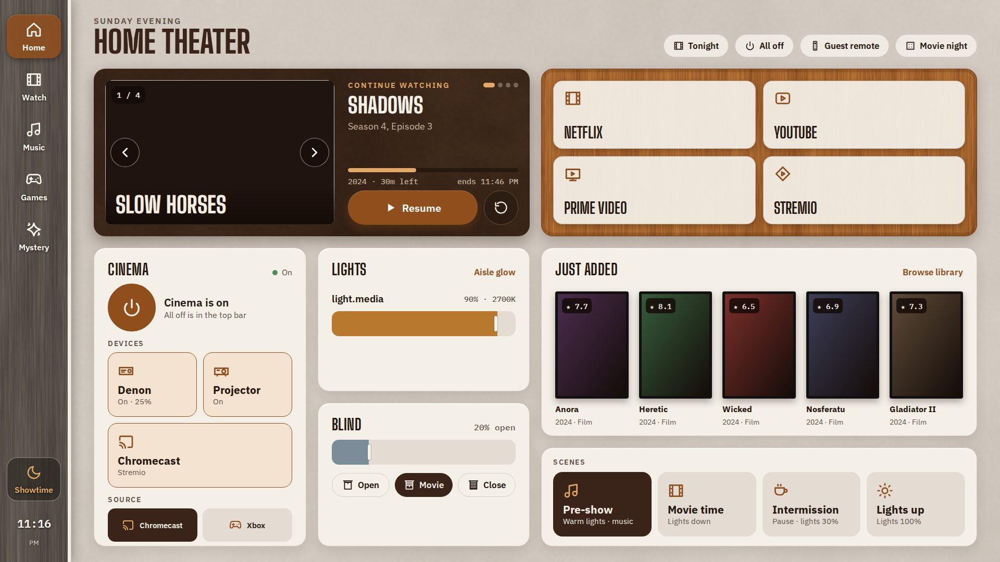
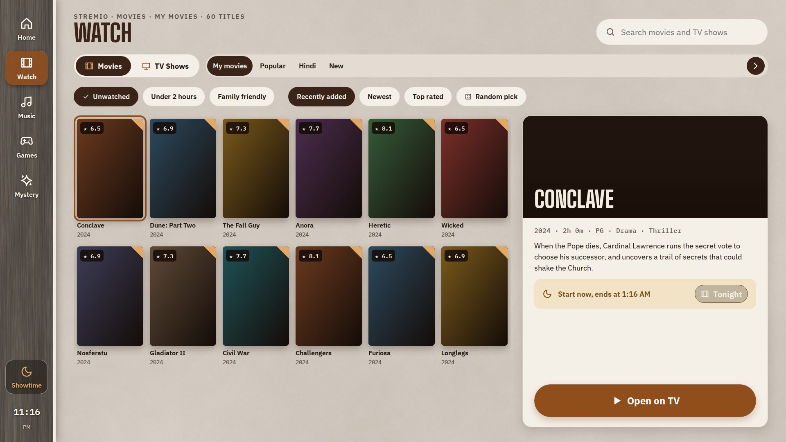
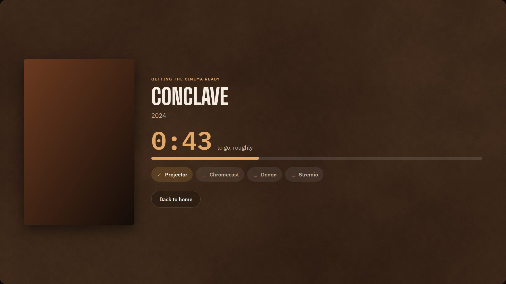
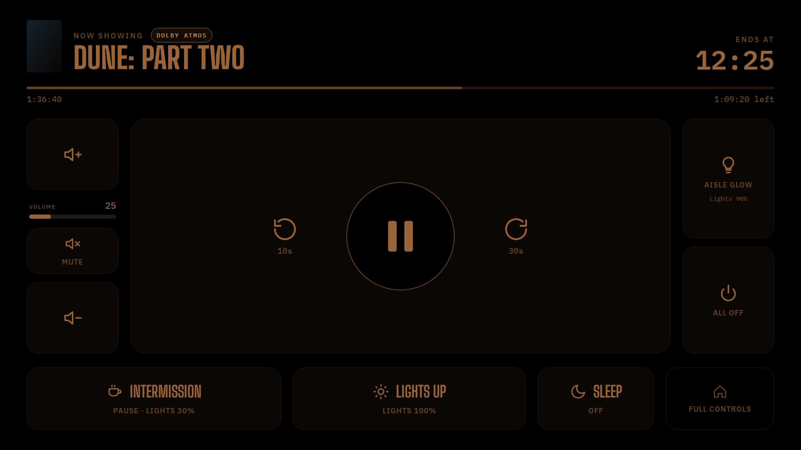
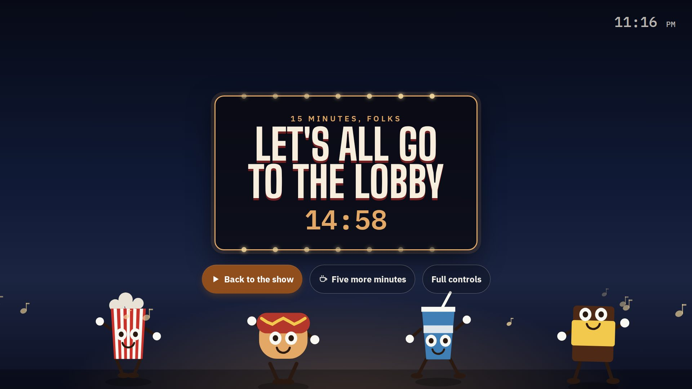
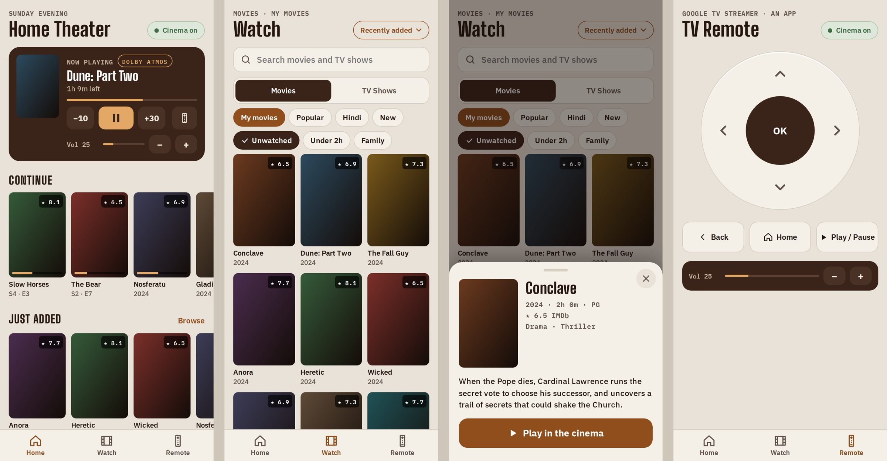

# Theater Panel (Stremio + Google TV fork)

A wall-panel app for a home cinema, run as a Home Assistant add-on. It turns a tablet on the wall
(and your phone) into the cinema's front of house: pick something to watch from your Stremio
library and catalogues, start the room in the right order, and run the lights, the blind, the
scenes and playback while the film is on.

This is a fork of [davidcoulson/theater-panel](https://github.com/davidcoulson/theater-panel),
which was built around Plex, Seerr and an Apple TV. This fork swaps the library for **Stremio**,
the player for a **Google TV Streamer**, and is tuned for a cinema with a **Denon AV receiver**
and a **projector**. Much of the upstream panel is still here and still works; the parts that
need services this fork doesn't use are listed under
[Inherited and not used here](#inherited-and-not-used-here).



*Screenshots in this README use sample titles and placeholder posters.*

---

## Contents

- [What it does, in one minute](#what-it-does-in-one-minute)
- [How it fits together](#how-it-fits-together)
- [The wall panel, screen by screen](#the-wall-panel-screen-by-screen)
- [The phone remote](#the-phone-remote)
- [Other screens: hallway, guests, movie night, marquee](#other-screens)
- [Starting and stopping the cinema](#starting-and-stopping-the-cinema)
- [Scenes](#scenes)
- [Sound: the Atmos badge](#sound-the-atmos-badge)
- [Holidays, birthdays and the look](#holidays-birthdays-and-the-look)
- [The panel as a Home Assistant device](#the-panel-as-a-home-assistant-device)
- [Install](#install)
- [Settings](#settings)
- [Access and security](#access-and-security)
- [Home Assistant setup](#home-assistant-setup)
- [Troubleshooting](#troubleshooting)
- [Inherited and not used here](#inherited-and-not-used-here)
- [For developers](#for-developers)

---

## What it does, in one minute

- **Browse and play.** Your Stremio library ("My movies", "My shows"), continue watching, and
  every catalogue your Stremio add-ons offer (Popular, New, by language...), with search,
  filters and sorting. Tap a title and **Open on TV**: the cinema starts if it's off, and Stremio
  opens the title's stream list on the Streamer.
- **Apps.** One-tap Netflix, YouTube, Prime Video and Stremio. The cinema starts first if needed.
- **Start the room properly.** A warm-up screen counts down while Home Assistant brings up the
  projector, the Streamer and the receiver in an order that keeps the picture and Dolby Atmos
  reliable (about a minute).
- **Run the room.** Scenes (Pre-show, Movie time, Intermission, Lights up, All off), lights and
  their effects, the blind (Open / Movie / Close), and each device on its own.
- **While the film plays.** A dark Showtime screen with pause, skip, volume, mute, intermission,
  lights up and a sleep timer, plus a badge showing whether the Denon is getting **Dolby Atmos**.
- **Intermission.** A 1950s drive-in snack bar takes the wall, with a countdown and a march in
  the room.
- **Your phone.** A phone-sized remote at `/remote`: what's playing, continue watching, scenes,
  devices, the blind, the whole Watch screen, and a TV remote pad for the Streamer.
- **Around the house.** A hallway mode for a screen outside the cinema, a guest remote by QR,
  movie-night voting from phones, and an idle "Now Showing" poster wall.
- **Seasons.** Holiday accents, falling snow or leaves, and birthday confetti on the day.
- **Home Assistant device.** The panel shows up in HA (through the ESPHome integration) with
  switches, sensors, buttons and actions, so automations and voice can use it too.

---

## How it fits together

```
 wall tablet ─┐                         ┌─▶ Stremio account API   library, continue watching, history
 (Fully Kiosk) │                         ├─▶ Cinemeta + add-ons    catalogues, search, details, posters
 phone /remote ├─http─▶ Theater Panel ───┤
 hallway tablet│        (this add-on)    └─▶ Home Assistant         one websocket, ~30 entities,
 guest phones ─┘                                                    theater_* scripts, Music Assistant
```

- The panel runs as its own add-on on the Home Assistant machine. It has **no build step and no
  framework**: a small Node server and a Preact page.
- **Home Assistant does the room logic.** Every button calls one allow-listed action, mostly a
  `script.theater_*`, so the same behaviour is available to wall switches, voice and automations.
  The panel never calls arbitrary HA services.
- It subscribes only to the entities it shows, so HA streams a few dozen entities to it, not the
  whole house.
- Posters are fetched once at display size and cached on disk (`image_cache_mb`).

---

## The wall panel, screen by screen

The wall panel is designed for a 1920×1080 tablet and scales to fit other screens. A rail on the
left switches between **Home**, **Watch**, **Music** and **Games**, with **Mystery** and
**Showtime** shortcuts and the clock.

### Home


| Part | What it does |
|---|---|
| **Header chips** | **Tonight** (plan an evening, see below), **All off** (second tap within 4 s confirms), **Guest remote** (QR for guests), **Movie night** (phone voting), **Mystery box**, the **sleep timer** when armed, and the cinema temperature when configured. |
| **Continue watching** | Your Stremio continue-watching list as a swipeable card: artwork, progress, "ends at" time, **Resume** and **Start over**. After a long gap it shows when you last watched. For a show it offers the next episode once the last one is finished. |
| **Apps** | Netflix, YouTube, Prime Video and Stremio as big buttons. With the cinema off, a tap starts it (the warm-up screen shows) and the app opens once the Streamer and receiver are up. |
| **Cinema** | Power state, a **Start the cinema** button, and the devices: **Denon** (with volume), **Projector** and **Chromecast** (with what it's showing: Netflix, YouTube, Spotify, Home screen...). Tapping a device switches it on; switching one off takes a second tap so a stray touch can't cut the picture mid-film. When the receiver is on, its **source** (Streamer or console) can be switched here. |
| **Lights** | Each light's brightness, its colour or temperature, and its **effect** (for WLED and other lights with effects: a searchable sheet of animated previews, grouped by mood, with favourites). **Aisle glow** drops the room to a low glow. |
| **Blind** | A position slider plus **Open**, **Movie** (20 %) and **Close**. |
| **Just added** | The newest titles in your library, five at a time (swipe for more). |
| **Scenes** | Pre-show, Movie time, Intermission, Lights up. The active scene is highlighted, and a tapped scene lights up immediately while Home Assistant catches up. |

### Watch



- **Movies | TV Shows** switch, then tabs: **My movies / My shows** (your Stremio library) and
  every catalogue your Stremio add-ons provide (Cinemeta's Popular, New and Featured, plus any
  language or genre catalogues from your own add-ons). Catalogues that support it get a
  **genre** (or year) picker.
- **Search** across Stremio.
- **Filters:** Unwatched, Under 2 hours (films), Family friendly. **Sort:** Recently added,
  Newest, Top rated, Random pick (catalogues keep their own order, so they offer Catalogue order
  or Random).
- Posters show IMDb ratings, an "unwatched" corner and progress bars.
- **The detail pane:** artwork, year, runtime, rating, genres, cast and director, the synopsis
  and "ends at" time. For shows: up next, seasons and episodes. **Open on TV** (or **Resume on
  TV**) and **Start over**. Long lists load more as you scroll.
- **Opening a title** sends Stremio's own deep link to the Streamer, which opens the title's
  stream list. With *auto-play first stream* on (an HA toggle), Home Assistant presses OK for you;
  otherwise you pick the stream with the TV remote or the phone's remote pad.

### Music

Music Assistant on the panel: what's playing, albums, playlists, artists and radio, search, the
queue, and which speaker to play on. The first music player in the settings is the cinema's.

### Warm-up



When you pick something with the cinema off, the panel shows what's coming, a countdown (about a
minute) and a live checklist (**Projector, Chromecast, Denon, Stremio**) ticking off as Home
Assistant reports each one up. If something is still missing after 4½ minutes it says which and
what to check. Once the title is on screen it tells you to pick a stream and moves on to Showtime.

### Showtime



The dark screen while something plays: near-black with dim amber controls.

- Title, a **sound-format badge** (see [Sound](#sound-the-atmos-badge)), "ends at" time and a
  progress bar.
- **Back 10 s / play-pause / forward 30 s**. For Stremio these go through Google Cast, which
  Stremio's player obeys; other apps get the remote's media keys.
- **Volume up / down / mute** on the Denon, with the current level.
- **Aisle glow**, **All off** (two taps), **Intermission**, **Lights up**, **Sleep** and **Full
  controls** (back to Home).
- It opens by itself when the Streamer starts playing, and goes back to Home when playback ends.
  Away from Kiosk Satellite's theater mode, the page dims its own controls and a tap brightens
  them for a few seconds.

### Intermission



When the scene becomes Intermission (from the panel, a phone, voice or an automation) the wall
becomes a drive-in snack bar: a marquee, a countdown (15 minutes by default), and popcorn, a hot
dog, a soda and a candy bar marching past. An **intermission march** plays once in the room on the
cinema speaker. **Back to the show** resumes; **Five more minutes** extends the break.

### Now Showing (idle)

After a few minutes untouched (8 by default) the panel drifts to a slow poster wall of what's in
progress and what was just added, like a cinema lobby board. Any touch brings it back.

### Mystery box

One unwatched film picked for you, with an eye on what the house has been watching, revealed with
a little ceremony and started after a countdown that can always be waved off. Rules (years, lowest
rating, longest runtime, genres to skip, family night...) are on the settings page.

### Year in review

What the house watched this year, from Stremio's watch history: plays, an estimate of hours (the
history records that something was watched, not for how long, so the screen says "about"), the
top ten and the longest sitting. Open it from Watch or at `#/year`.

### Tonight

Plan an evening around one film: pick the film and a time (or now). The panel runs pre-show
lights, then trailers for films the house hasn't seen (played in a YouTube app on the Streamer),
then the feature, and gives a long film an intermission at the halfway mark. The plan is what the
[marquee](#other-screens) shows.

### Sleep timer and the end of the film

- **After this film** turns the room off when playback ends; **30–120 minutes** turns it off after
  that long.
- With nothing armed, the lights still come up slowly when the film ends, the way a cinema's do.
- The server holds the timer, so it keeps its word even if the panel reloads or goes idle.

### "How was it?"

When a film finishes, the panel asks for a quick star rating (skipped on hallway screens). Low
ratings can be kept out of the Mystery box.

---

## The phone remote



Open **`/remote`** on a phone (for example `http://<home-assistant-ip>:8787/remote`). It's a
separate page laid out for phones; the wall panel is unchanged.

**Home**
- **Now playing:** title (from Stremio, or from Google Cast for YouTube, Spotify and others), the
  sound-format badge, progress, **−10 / play-pause / +30**, a **TV remote** shortcut, and the
  Denon's volume.
- **Continue** and **Just added** as swipeable rows.
- **Scenes** and **All off** (two taps).
- **Devices:** Projector, Denon, Chromecast (two taps to turn one off).
- **Blind:** Open / Movie / Close.

**Watch**
- Search, Movies | TV Shows, the catalogue tabs, the same filters and sort as the wall panel, and
  the app buttons.
- Tapping a poster opens a sheet with the details and **Play in the cinema** (or **Resume**),
  **Start over**, and seasons and episodes for shows. If the cinema is off, the sheet says so
  and the cinema starts first.

**Remote**
- A round pad (**up, down, left, right, OK**), **Back**, **Home** and **Play / Pause** for the
  Google TV Streamer, plus the Denon's volume. This is how you pick a stream in Stremio without
  finding the physical remote.

**Using it from Home Assistant.** Point a dashboard button at the page with a `url` tap action.
It needs the panel to trust the phone's address (see [Access](#access-and-security)); from outside
the house that works over a VPN such as Tailscale.

---

## Other screens

| Screen | Address | What it is |
|---|---|---|
| **Hallway** | `/?role=hallway` | For a screen outside the cinema. It picks what to play and shows what's on, but never goes dark, never acts as the in-room remote and never asks "how was it?". Showtime becomes a lit **Now Playing** board with the poster (or the app's icon for Netflix and other apps). A **Dashboard** button returns to your HA dashboard, and with the cinema off it goes back there by itself after a few minutes. |
| **Guest remote** | QR on Home → `/guest?t=…` | A phone page for guests for the evening: play-pause, −10 / +30, volume, aisle glow, Intermission, Movie time, Lights up. No key needed; the link expires after 6 hours (configurable) or when you end it. |
| **Movie night** | Home → Movie night, phones open `/vote` | The panel shortlists films; everyone votes from their phone by scanning a QR; the tallies show live on the wall. Tap a poster to play the winner. |
| **Marquee** | `/marquee` | A poster board for a screen outside the room showing tonight's plan and times. |

Deep links work for every wall screen, for example `#/watch`, `#/showtime`, `#/year`,
`#/lobby?mystery=1`. Home Assistant can move every open panel to one with the
`esphome.theater_panel_navigate` action.

---

## Starting and stopping the cinema

The panel doesn't switch hardware itself: it turns on an `input_boolean` (the "movie scene"),
and Home Assistant scripts do the rest. This is what the reference setup does and why. Your own
scripts can differ; the panel only needs the entities in [Settings](#settings).

**Start (about 45–60 seconds):**
1. Lights to the cinema scene; the blind to 20 % in daylight.
2. **Projector on**, then wait for it.
3. **Streamer on** about 10 s later, then wait for it.
4. **Receiver on last**, about 15 s later, retrying once if it doesn't answer, then its input
   set to the Streamer (it keeps its last input, so after a game it would still be on the console).
5. The panel's warm-up screen follows along, then the title or app opens.

Why this order: with a Google TV Streamer, a Denon and a projector, Dolby Atmos only came through
reliably when the receiver powered on *after* the projector and the Streamer were already up.
Starting the receiver first, or having the projector wake up afterwards, left the Streamer
sending PCM. The projector also needs a settled signal to avoid a blank picture.

**A console on the same receiver:** the Cinema card's **Source** tiles switch the receiver
between the Streamer and the console. When you open a film or an app from the panel while the
receiver is on another input, the panel switches it back to the Streamer first. While the
receiver is on and on the console's input with the movie scene off (a gaming session started from
HA), the panel shows **Xbox is on** with **All off**, instead of offering to start the cinema.

**Stop (All off):** lights and blind back to how they were, the Streamer, receiver and projector
off, and the movie scene off. The receiver goes to **standby** rather than having its power cut,
which keeps the next start fast. Turn off the receiver's Zone 2 so standby stays at a few watts.

---

## Scenes

| Scene | Script | What it does |
|---|---|---|
| **Pre-show** | `script.theater_pre_show` | Starts the cinema if it's off, warm lights, and a film-score playlist that starts on a small speaker straight away and moves to the receiver (mid-song) once the room is up. |
| **Movie time** | `script.theater_movie_time` | Lights down for the film, music faded out. |
| **Intermission** | `script.theater_intermission` | Pauses playback and brings the lights to 30 %. |
| **Lights up** | `script.theater_lights_up` | Lights to full. |
| **All off** | `script.theater_all_off` | The whole cinema off (see above). |
| Aisle glow | `script.theater_aisle_glow` | A low glow to find your way. |

An `input_select.theater_scene` remembers which scene is active, so every screen highlights the
same one. An optional automation dims the lights when Netflix or Stremio starts playing
(`input_boolean.theater_auto_lights` turns it off).

---

## Sound: the Atmos badge

While something plays, Showtime and the phone show what the Denon is decoding, read from its
`sound_mode_raw`:

| Badge | Meaning |
|---|---|
| **Dolby Atmos** (amber) | Atmos is coming through. |
| **Dolby** / **DTS** | A surround format without Atmos objects. |
| **Multichannel** | Multichannel PCM. Normal for menus and non-Atmos sound: the Streamer and an Xbox both send it between Atmos titles. |
| **Stereo · no Atmos** (red) | A stereo signal being upmixed. Usually the HDMI handshake went wrong at start-up; switching the receiver off and on with the Streamer already running fixes it. |

---

## Holidays, birthdays and the look

- **Themes:** *classic* (chocolate) or *sofa* (slate).
- **Holiday accent:** `auto` follows the calendar, or pick one. Each accent changes the highlight
  colour, the rail's glow, a small emblem by the clock and the "weather" over Home: bats at
  Halloween, snow at Christmas, confetti at New Year, hearts for Valentine's, and petals,
  fireflies, leaves or snow for the seasons. The `auto` calendar in this fork follows the
  **southern hemisphere** (summer in December–February).
- **Birthdays:** list `Name=MM-DD` on the settings page; on the day the panel switches to the
  birthday accent with confetti.
- **Holiday shelves:** with a TMDB key and a list per season, Watch gets a Halloween or Christmas
  shelf while the season lasts.
- **Cinema mode:** the panel dims itself when the room is dark.

---

## The panel as a Home Assistant device

The panel speaks the ESPHome native API, so HA's own **ESPHome** integration adds it like a
board: Settings → Devices & services → Add integration → ESPHome, host = your HA machine's
address, port **6053**.

| Kind | Entities |
|---|---|
| Selects | Theme, Holiday accent, Sleep timer |
| Number | Accent weather (0–100 %) |
| Switches | Cinema mode, Pre-roll |
| Buttons | Mystery box, Surprise me, and one per scene (Pre-show, Movie time, Intermission, Lights up, All off) |
| Sensors | Now playing, Tonight, Playback progress, Film playing, Panels open, Active accent, Build, Panel online |
| Event | Mystery box pick (picked / started) |
| Update | Panel image |
| Actions | `esphome.theater_panel_play`, `…_navigate` (move panels to a route), `…_scene`, `…_voice` |

Voice sentences for Assist are in `ha/custom_sentences/en/`.

---

## Install

1. In Home Assistant: **Settings → Add-ons → Add-on store → ⋮ → Repositories**, add
   `https://github.com/spamolution-dotcom/theater-panel`.
2. Install **Theater Panel**, fill in the options below and start it.
3. Open `http://<home-assistant-ip>:8787` on the wall tablet (Fully Kiosk Browser or Kiosk
   Satellite work well), and `/remote` on your phone.
4. Create the `theater_*` scripts and helpers in Home Assistant (see
   [Home Assistant setup](#home-assistant-setup)).
5. Optional: add the panel as an ESPHome device (above).

The add-on updates itself when a new version is published (turn auto-update on in HA).

### Add-on options

| Option | What it does |
|---|---|
| `stremio_email`, `stremio_password` | Your Stremio account. The add-on signs in once and keeps the session key in `/data`. |
| `admin_password` | Turns on the settings page at `/admin`. |
| `trust_networks` | Addresses that can use the panel without its key, comma-separated (e.g. `192.168.1.0/24`). |
| `allow_open` | `true` lets anyone who can reach the panel use it without a key. |
| `public_url` | The panel's own address as other devices see it (used for the speaker sounds and QR codes). |
| `preroll` | A short "lights down" swell on the cinema speaker before a film, which delays the start by about 16 seconds. Off is a fine choice when you use the Pre-show music. |
| `tmdb_api_key` | Optional: holiday shelves and recommendations. |
| `dashboard_url`, `hallway_return_minutes` | Where the hallway screen's Dashboard button goes, and after how many idle minutes (cinema off) it goes back there by itself. |
| `image_cache_mb` | Poster cache size (default 300). |

---

## Settings

Everything else lives on the settings page at **`/admin`** (protected by `admin_password`). What
is saved there wins over the add-on options and survives updates. The main groups:

- **Home Assistant:** URL and token (filled in automatically in the add-on).
- **Entities:** the Streamer (media player and remote), the Cast entity, the receiver, the
  projector, the movie-scene boolean, the start-up script, lights, blind, music players,
  temperature, projector temperatures and more. Entity ids live here, so the HA scripts stay
  generic.
- **Home Assistant device:** the ESPHome device on/off, name, port and encryption key.
- **Display:** theme, accent, accent weather, birthdays, idle minutes, cinema mode, poster
  badges, and pages allowed to embed the panel.
- **Projector apps, pre-roll, intermission:** sound URLs, lengths and the intermission length.
- **Tonight:** trailers on/off, how many and how long, pre-show minutes, automatic intermission
  for long films, how long a guest remote lasts.
- **Mystery box:** years, lowest rating, longest runtime, genres, family night and more.
- **Year in review:** the date to send the year's summary to phones, and to whom.
- **Access:** trusted networks and trusted proxies.

Seven taps on the version number in the wall panel's rail open a small sheet with the harmless
settings (look, Mystery box rules, pre-roll timing).

---

## Access and security

- Without `allow_open`, the panel makes a **key** on first start. Devices on a **trusted
  network** skip it; any other device needs to open the panel once with `?key=<key>`, after which
  the browser keeps a cookie.
- **Phones away from home:** use a VPN such as Tailscale rather than exposing the panel to the
  internet. Add Tailscale's range (`100.64.0.0/10`) to `trust_networks`. On Home Assistant OS,
  connections that arrive through the Tailscale add-on can reach the panel from HA's internal
  gateway address (`172.30.32.1`), so add that too if you still see the key page.
- Don't publish the panel through a public tunnel without your own sign-in in front of it: it can
  switch the cinema on and off.
- Every POST must be JSON from the panel's own pages, so other sites on the network can't drive
  the room through a trusted browser.
- The settings page uses its own password, its cookie is HttpOnly and SameSite=Strict, and
  secrets are write-only.
- The panel can only run the actions in `server/actions.mjs`, not arbitrary HA services.

---

## Home Assistant setup

`ha/theater-stremio.yaml` has the scripts, helpers and the lights automation this fork expects:

- **Helpers:** `input_select.theater_scene` and `input_boolean.theater_auto_lights`.
- **Scripts:** `theater_play_stremio` (open a title, starting the cinema first), the scenes,
  `theater_lights_*`, `theater_curtain`, `theater_aisle_glow`, `theater_preroll`,
  `theater_snipe` (play a sound in the room).
- **Optional:** `script.theater_music_fade` (fade the Pre-show music out before an app opens). It
  lives in your own HA, not this file; without it the music is simply cut when the film starts.
- **Automation:** lights follow the Streamer (Movie time when Netflix or Stremio starts).

The cinema's own power-up and shut-down live in your HA (a movie-scene boolean that runs a start
script and an end script); the panel only needs to know the boolean and the start script's
entity.

**Nice extras (not part of the add-on):** a phone notification while a film plays with **Pause**
and **Intermission** buttons; a dashboard button that opens `/remote` on tap and toggles the movie
scene on hold.

---

## Troubleshooting

| Symptom | What to check |
|---|---|
| **Stereo · no Atmos** badge | Restart the receiver with the Streamer already on. If it keeps happening, check the start order (receiver last) and turn off the receiver's **HDMI Control** (CEC), which can renegotiate audio when the projector wakes. |
| Blank picture at start | The projector should come on after the receiver and Streamer have settled. |
| Warm-up says "taking longer than usual" | It names the device that didn't come up. Check that device, or turn the movie scene off and on. |
| Phone shows "Open this page once with ?key=…" | The phone's address isn't trusted. Add its network to `trust_networks` (see [Access](#access-and-security)). |
| Phone shows "Can't reach the cinema panel" | You're not on the home network or the VPN. |
| A scene button doesn't stay lit | The scene only shows as active while the cinema is on; it lights up straight away on tap and settles once HA reports it. |
| "Home screen" shown while an app plays | The app doesn't report to Google Cast. Netflix, Stremio, YouTube, Prime Video, Spotify, Disney+ and Plex are recognised by name. |

---

## Inherited and not used here

These come from the upstream panel. The code is still in the repo, but they need services or
hardware this fork doesn't use, so they are hidden or inactive:

| Feature | Needs | State in this fork |
|---|---|---|
| **Request** (Seerr search, requests, download queue) | Seerr | Hidden from the rail; `#/request` still opens it. |
| Plex libraries, sessions, "N streams", Tautulli | Plex | Replaced by Stremio. |
| **Games** (consoles via an HDMI switcher, Steam library, PC stats) | `config/games.json`, Steam key | The tab is there but empty without a games config. |
| **Soundbar** sheet | A JBL soundbar in HA | Only appears when a soundbar is configured. |
| Kiosk Satellite theater mode | The Kiosk Satellite app | Works if you use it; with Fully Kiosk the page dims itself. |
| Basement panel, Unraid template | — | Not used. |

---

## For developers

- `server/`: the Node server. `index.mjs` (HTTP, SSE, routing), `actions.mjs` (every allow-listed
  action), `stremio.mjs` (library, catalogues, history), `ha.mjs` (HA websocket), `hass.mjs` (the
  ESPHome device), `config.mjs` (settings and entity ids), `admin.mjs` (settings page).
- `web/`: the wall app (`index.html`, `app.mjs`, `views/`), the phone remote (`remote.html`,
  `remote.mjs`), and shared helpers in `web/lib/`.
- `theater_panel/`: the Home Assistant add-on (bump `version` in `config.yaml` for each release).
- `ha/`: Home Assistant YAML.
- No build step: edit, restart, reload. `npm run dev` runs the server locally with a `.env`.

Credits: built on [davidcoulson/theater-panel](https://github.com/davidcoulson/theater-panel).
